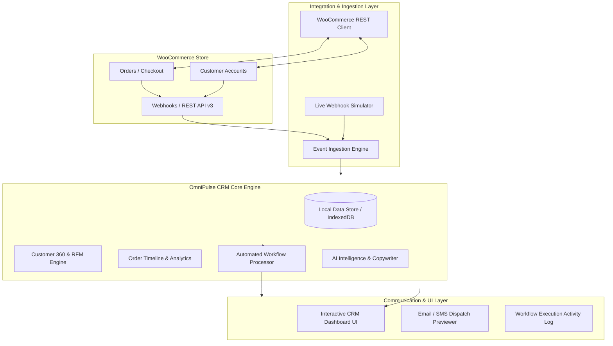

# WooCommerce CRM System Integration — Hackathon Project Plan

**Project Title:** OmniPulse CRM for WooCommerce  
**Challenge:** WooCommerce CRM System Integration (Kilowott Hackathon)  
**Author / Team:** Hackathon Team  
**Date:** October 2026  
**Status:** In Progress / Active Implementation  

---

## 1. Executive Summary & Objective

Modern e-commerce brands running on WooCommerce often suffer from fragmented customer data. Customer profiles are scattered across basic WordPress user tables, order statuses are trapped in the order queue, and marketing or support outreach happens in silos without context.

**OmniPulse CRM** solves this by delivering an enterprise-grade, real-time Customer Relationship Management (CRM) dashboard designed specifically for WooCommerce stores. It transforms raw WooCommerce orders and customer accounts into:
1. **360° Customer Profiles & RFM Segmentation** (Recency, Frequency, Monetary value).
2. **Real-time Order Synchronization & Lifecycle Tracking** with metrics on average order value (AOV), lifetime value (LTV), and churn probability.
3. **Automated Communication Workflows** that trigger custom multi-channel actions (Welcome emails, Order fulfillment alerts, Win-back discounts, VIP rewards) based on WooCommerce events.
4. **AI-Powered Customer Intelligence** providing one-click summaries, sentiment insights, and tailored outreach copy.
5. **Dual-Mode Connectivity**: Seamless connection to live WooCommerce REST API (`/wp-json/wc/v3`) alongside a built-in interactive **Webhook Simulator** for demonstrations.

---

## 2. System Architecture & High-Level Flow



---

## 3. Core Functional Modules

### Module 1: Customer Data Management (Customer 360°)
* **Unified Profile**: Aggregates customer contact details, billing/shipping address, total spend, total orders, average order value (AOV), and customer registration date.
* **Smart Segmentation & Tags**:
  * `👑 VIP Customer`: Total spend > $500 or > 5 orders.
  * `⭐ High Value`: Orders with high basket values.
  * `🌱 First-Time Buyer`: Single completed purchase.
  * `⚠️ At Risk / Churn`: Inactive for > 60 days with past orders.
  * `🎯 Active Prospect`: Registered but zero orders.
* **Activity & Interaction Log**: Records every customer interaction, notes taken by agents, and sent communications.

### Module 2: Order Tracking & Pipeline Management
* **Order Sync**: Real-time synchronization of WooCommerce orders with statuses (`Pending payment`, `Processing`, `On hold`, `Completed`, `Cancelled`, `Refunded`).
* **Order Item Breakdown**: Displays product names, quantities, unit prices, tax, and order totals.
* **Order Pipeline / Kanban View**: Visual drag-and-drop or status switcher to trace the lifecycle of each order from checkout to fulfillment.
* **Key Store Metrics**:
  * Total Store Gross Merchandise Value (GMV).
  * Total Orders & Fulfilled Rate.
  * Customer Lifetime Value (CLV) distribution.

### Module 3: Communication Workflows (Rule Engine)
* **Visual Rule Builder**:
  * **Triggers**:
    * `order.created` (New order placed).
    * `order.completed` (Fulfillment delivered).
    * `order.cancelled` / `order.refunded` (Customer retention/support).
    * `customer.inactive` (No purchase in 30+ days).
    * `customer.first_order` (New buyer onboarding).
  * **Conditions**: E.g., Order value > $100, or Customer tag = VIP.
  * **Actions**:
    * Dispatch personalized transactional email.
    * Send SMS order status update.
    * Auto-generate a single-use discount coupon code.
    * Create a follow-up task for customer support.
* **Execution History**: Audit trail displaying when rules executed, recipient details, and message contents.

### Module 4: WooCommerce Integration & Simulation Layer
* **Live Connection Credentials**:
  * Store URL (`https://example.com`)
  * Consumer Key (`ck_...`)
  * Consumer Secret (`cs_...`)
  * Connection health check indicator (Ping `/wp-json/wc/v3/system_status`).
* **Built-in Webhook Simulator**:
  * One-click trigger buttons to simulate instant customer purchases, cancellations, and customer registrations.
  * Perfect for hackathon presentations to demonstrate live reactive updates without requiring a live checkout process.

### Module 5: AI Customer Intelligence
* **Customer Summary Generator**: Summarizes customer order behavior, preferred product categories, and buying frequency into 2 punchy bullet points.
* **Churn Risk Predictor**: Calculates risk score based on days since last order and previous order frequency.
* **AI Outreach Email Generator**: Produces tailored emails (VIP Appreciation, Re-engagement, or Order Follow-up) ready to preview and send.

---

## 4. End-to-End Event Flow

```
[Customer checks out on WooCommerce]
                │
                ▼
  [WooCommerce fires `order.created` webhook]
                │
                ▼
  [OmniPulse Event Ingestion Layer]
   ├── Updates or Creates Customer Record in CRM
   ├── Appends Order to Customer Purchase Timeline
   └── Recalculates Customer Lifetime Spend & RFM Tier
                │
                ▼
  [Workflow Engine Evaluates Active Rules]
   ├── Match Trigger: `order.created`
   ├── Match Condition: `order.total >= $50`
   └── Action: Dispatch "Thank You & Tracking Link" + Record Log
                │
                ▼
  [CRM Dashboard UI Updates Instantly]
   ├── Toast Notification appears
   ├── Metrics counters increment in real-time
   └── Customer record displays the new interaction
```

---

## 5. Technology Stack

* **Frontend Framework**: Modern HTML5, Modular ES6+ JavaScript (Clean, maintainable, reactive state management).
* **Styling**: Pure Custom CSS (Design tokens, modern dark glassmorphism theme, dynamic animations, modern typography with Outfit & Inter, fully responsive).
* **Icons & Visuals**: Clean inline SVG iconography and modern data badges.
* **Tooling & Dev Server**: Vite for ultra-fast bundling and instant Hot Module Replacement (HMR).
* **Storage**: In-memory + `localStorage` persistence with seed sample data and instant reset capability.

---

## 6. Hackathon Presentation & Demo Script (3-Minute Winning Pitch)

* **Minute 1: The Problem & Solution (Slide + CRM Home)**
  * Introduce why WooCommerce stores struggle with customer retention due to lack of a native CRM.
  * Show OmniPulse CRM's executive dashboard with live metrics (Revenue, Customers, Orders, Active Workflows).
* **Minute 2: Customer 360° & AI Insights**
  * Click on a high-value customer (e.g., "Sophia Reynolds").
  * Show complete purchase history, RFM VIP badge, and customer notes.
  * Click **"Generate AI Outreach"** to draft a personalized retention message in seconds.
* **Minute 3: Real-Time Sync & Workflow Automation (The Climax)**
  * Open the **Webhook Simulator** or place an order.
  * Fire a simulated `New Order ($249.00)` event.
  * Show the live toast notification, customer spend incrementing, and the **Automated Workflow** firing (dispatching a VIP welcome email in the activity feed).
  * Show the **Settings** panel proving live WooCommerce REST API credentials support.

---

## 7. Implementation Checklist & Milestones

- [x] Hackathon project evaluation and topic selection.
- [x] Architecture design & comprehensive `PROJECT_PLAN.md`.
- [x] Project scaffolding with Vite and clean file hierarchy.
- [x] Design system tokens and responsive dark theme CSS.
- [x] Core Data Store & WooCommerce REST API client / simulator.
- [x] Dashboard View: Store metrics, analytics charts, recent activity.
- [x] Customers View: Customer 360° directory, filters, RFM tags, drawer/modal.
- [x] Orders View: Orders pipeline, status badges, details view, Table & Kanban view.
- [x] Automation Workflows View: Active rules, rule builder, execution log.
- [x] Analytics & RFM Matrix View: Cohort counts, category revenue, fulfillment stats.
- [x] AI Copilot Integration: Profile summary, tone selector, email generator.
- [x] Live Webhook Simulator: Instant event firing for live judging.
- [x] Data Export Tools: Customer and Order CSV download engines.
- [x] Verification, local server live execution, and comprehensive documentation (`WALKTHROUGH.md`, `FUNCTIONAL_SPECIFICATION.md`).
